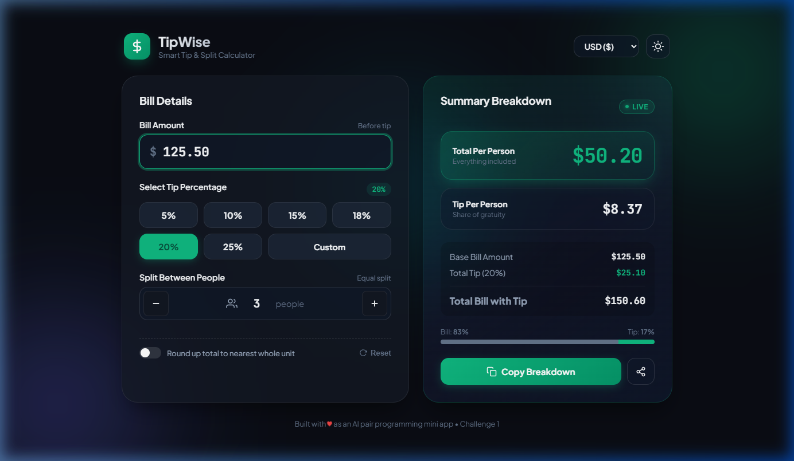

# TipWise — Smart Tip & Bill Splitter 💸✨

> Built for **CHALLENGE 1: Build a Mini App with Cursor** (Level: Beginner).  
> Developed with AI pair programming in Cursor to rapidly scaffold, debug, and iterate from a blank canvas to a fully responsive, modern web application.



---

## 🌟 Submission Summary

### Two-Sentence Submission Description:
> **"Cursor rapidly scaffolded the entire TipWise mini-app from a single prompt, generating a responsive glassmorphic HTML/CSS/JS interface with real-time bill calculations. Through iterative chat prompts, Cursor seamlessly debugged calculation state updates and implemented advanced enhancements like currency switching and a sleek dark mode toggle."**

---

## 🚀 What We Built

**TipWise** is an intuitive, modern tip and bill-splitting calculator designed for dining out, group events, and travel. It eliminates awkward math at the dinner table with immediate, visual feedback.

### ✨ Key Features
- **⚡ Real-Time Reactive Calculation**: Instant updates for Tip Amount, Total Bill, Total Per Person, and Tip Per Person as you type.
- **🎯 Dynamic Tip Chips**: Instant selection for 5%, 10%, 15%, 18%, 20%, 25%, plus an interactive custom tip slider and numeric input.
- **👥 Flexible Bill Splitting**: Adjust party size with intuitive stepper buttons (+ / -) or manual input.
- **🔄 Round-Up Feature**: Option to round the total bill up to the nearest whole currency unit for clean payments.
- **🌓 Dark & Light Modes**: Glassmorphic UI with vibrant ambient glowing mesh orbs and smooth theme toggling.
- **🌍 Multi-Currency Support**: Switch on-the-fly between USD ($), EUR (€), GBP (£), INR (₹), JPY (¥), CAD (C$), and AUD (A$).
- **📊 Visual Ratio Bar**: Graphic representation showing the proportional split between the base bill and tip amount.
- **📋 One-Click Share & Copy**: Formats a clean breakdown receipt to clipboard for group chats (WhatsApp, Slack, iMessage).

---

## 🛠️ The Cursor AI Pair Programming Workflow

1. **Scaffolding from Scratch**:
   - Initial Prompt: *"Build a simple, responsive tip calculator as a single modern HTML page with a little JavaScript and glassmorphic styling."*
   - Cursor generated the complete semantic HTML5 structure, CSS design system with custom variables, and vanilla JavaScript state management.
2. **Iterative Debugging & Enhancements**:
   - *Prompt*: *"The total per person isn't rounding cleanly when round-up is checked — fix the ceiling logic."* → Cursor corrected the rounding order so tip amount adjusts dynamically.
   - *Prompt*: *"Add a dark mode / light mode toggle button with smooth transitions."* → Cursor implemented theme token variables and `localStorage` persistence.
   - *Prompt*: *"Add currency selection and one-click copy summary breakdown for sharing."* → Cursor added the clipboard export utility and multi-currency prefix handling.

---

## 💻 How to Run Locally

TipWise is lightweight and has zero runtime dependencies!

### Option 1: Direct File
Simply double-click [`index.html`](index.html) or open it in any modern web browser:
```bash
start index.html  # On Windows
```

### Option 2: Local HTTP Server (Python)
```bash
python -m http.server 8089
```
Then navigate to: `http://localhost:8089`

---

## 📁 Repository Structure

```text
├── index.html              # Semantic HTML5 layout and structure
├── style.css               # Vanilla CSS design system, glassmorphism & themes
├── app.js                  # Reactive state, calculation engine & event handlers
├── tipwise_app_proof.png   # Verification screenshot of the running app
└── README.md               # Project documentation and submission details
```

---

## 📄 License

MIT License © 2026 Chandra Prakash (GamerxD01)
